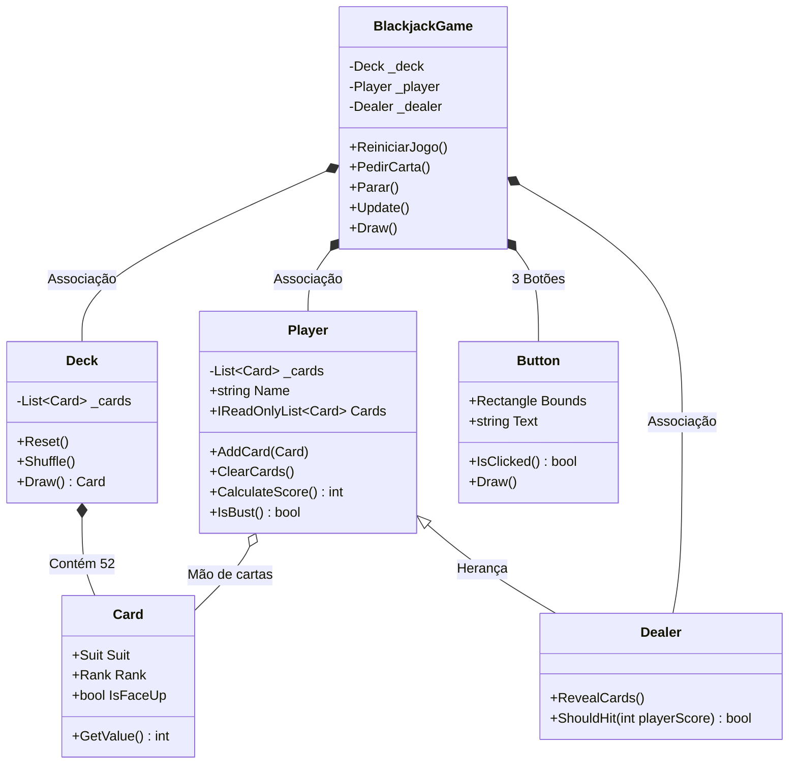

# Design Document - Blackjack com Raylib-cs (POO Simplificado)

## Overview
Arquitetura enxuta e direta para um projeto acadêmico de curto prazo em **Programação Orientada a Objetos (POO)**, seguindo exatamente as 5 classes sugeridas pelo professor (**Carta**, **Baralho**, **Jogador**, **Banca**, **Jogo**) mais um componente simples de **Botão** para a interface gráfica Raylib-cs.

### Por que NÃO usar Interfaces (`IDeck`, `IHand`) neste projeto?
Em projetos corporativos grandes, interfaces são usadas quando existem **múltiplas implementações diferentes** para o mesmo contrato (ex: `BaralhoComum` vs `BaralhoTrucadoParaTestes`, ou diferentes bancos de dados). Como neste projeto acadêmico existe apenas **um** tipo de baralho e **um** tipo de jogador/banca, criar interfaces apenas duplicaria arquivos sem trazer benefício prático. Por isso, optamos por **classes concretas coesas e herança direta (`Dealer : Player`)**.

---

## Architecture

Apenas **6 arquivos** dentro de `src/` (2 por membro do grupo):

---

## Mapeamento Direto com a Especificação do Professor

| Classe Sugerida | Arquivo no Projeto | Responsável | Conceito POO Principal |
| :--- | :--- | :--- | :--- |
| **Carta** | `src/Models/Card.cs` | Membro 1 | Classe, Construtor, Encapsulamento e Enums |
| **Baralho** | `src/Models/Deck.cs` | Membro 1 | Encapsulamento de lista e Associação com `Card` |
| **Jogador** | `src/Models/Player.cs` | Membro 2 | Métodos, Atributos e Regra do Ás (11 ou 1) |
| **Banca** | `src/Models/Dealer.cs` | Membro 2 | **Herança** (`Dealer : Player`) e IA de decisão |
| **Jogo** | `src/Game/BlackjackGame.cs` | Membro 3 | Associação entre todas as classes e Regras da Partida |
| *(Interface UI)* | `src/UI/Button.cs` | Membro 3 | Botões clicáveis ("Pedir Carta", "Parar", "Reiniciar Jogo") |
