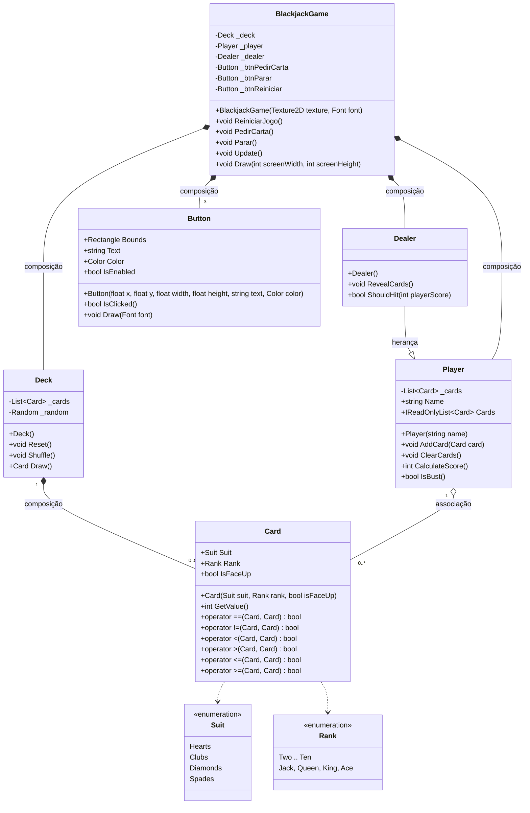

# ♠️ Blackjack 21 — Programação Orientada a Objetos

Trabalho prático da disciplina de **Programação Orientada a Objetos (POO)** — **Universidade Federal de São Paulo (Unifesp)**.

O projeto consiste na implementação do clássico jogo de cartas **Blackjack (21)** desenvolvido em **C# (.NET 10)** com interface gráfica renderizada em tempo real via biblioteca **Raylib-cs**. A arquitetura do sistema foi estruturada com foco na aplicação prática dos princípios e pilares da orientação a objetos: encapsulamento, herança, polimorfismo, associação, composição e sobrecarga de operadores.

---

## 📌 1. Visão Geral do Projeto

O Blackjack (ou 21) é um jogo de cartas onde o participante compete diretamente contra a **Banca** (*Dealer*). O sistema conta com:
- **Linguagem & Plataforma**: C# (.NET 10)
- **Biblioteca Gráfica**: [Raylib-cs](https://github.com/ChrisDill/Raylib-cs) (v8.1.0)
- **Resolução de Tela**: Janela HD (1280 x 720 pixels) a 60 FPS com anti-aliasing (MSAA 4x) e VSync.
- **Assets Gráficos e Tipografia**:
  - Atlas de sprites com as 52 cartas no estilo Balatro (`balatro_playing_cards_assets.png`).
  - Fonte vetorial suavizada (`font.otf`) com suporte integral a caracteres acentuados da língua portuguesa (Latin-1).
  - Mesa verde de cassino customizada, com molduras decorativas, sombras projetadas nas cartas e botões interativos com efeitos de realce (*hover*).

---

## 2. Regras do Jogo Implementadas

1. **Objetivo Principal**: Obter uma pontuação superior à da Banca sem ultrapassar o limite máximo de 21 pontos.
2. **Valores das Cartas**:
   - **Cartas Numéricas (2 a 10)**: Valem seu valor de face (2 a 10 pontos).
   - **Figuras (Valete / Dama / Rei — J, Q, K)**: Valem 10 pontos cada.
   - **Ás (Ace)**: Possui valor dinâmico. Inicialmente é contabilizado como **11 pontos**. Caso a soma total da mão ultrapasse 21 e haja um ou mais Ases na mão, o valor de cada Ás é sucessivamente convertido para **1 ponto** (-10 na pontuação acumulada por Ás) até que a soma fique menor ou igual a 21 ou até que todos os Ases sejam convertidos.
3. **Distribuição Inicial**:
   - O baralho de 52 cartas é redefinido e completamente embaralhado.
   - Tanto o Jogador quanto a Banca recebem 2 cartas do baralho.
   - A segunda carta da Banca permanece **oculta** (virada para baixo, `IsFaceUp = false`) até a conclusão do turno do jogador.
4. **Mecânica das Ações**:
   - **Pedir Carta (*Hit*)**: O jogador recebe mais uma carta do baralho. Se sua pontuação ultrapassar 21, ocorre o **estouro (*bust*)**: a partida é encerrada imediatamente, as cartas da banca são reveladas e a vitória é concedida à Banca.
   - **Parar (*Stand*)**: O jogador finaliza seu turno mantendo sua pontuação atual. Em seguida, a Banca revela sua carta oculta e joga automaticamente através de sua regra de decisão.
   - **Lógica e Decisão da Banca (*Dealer AI*)**: A Banca compra cartas consecutivamente enquanto sua pontuação for estritamente menor do que a pontuação do jogador e menor do que 21 (`ShouldHit`). Caso sua pontuação já seja suficiente para empatar ou superar o jogador (ou se atingir 21), a Banca para.
   - **Critério de Vitória e Desempate**:
     - Se o Jogador estourou (> 21), a Banca vence.
     - Se a Banca estourar (> 21), o Jogador vence.
     - Se nenhum dos dois estourou e a pontuação da Banca for **maior ou igual** à pontuação do Jogador, a **Banca vence** (conforme especificação acadêmica de regras do projeto, **o empate favorece a banca**).
     - Se a pontuação final do Jogador for maior que a da Banca (sem estouro), o Jogador vence.
   - **Reiniciar Jogo**: Limpa as mãos, recompõe e reembaralha o baralho, distribuindo duas novas cartas para cada participante.

---

## 3. Arquitetura e Conceitos de POO Aplicados

O projeto foi dividido em classes de domínio bem delimitadas, demonstrando a aplicação prática dos conceitos fundamentais de POO:



### Detalhamento das Classes

### 1. `Card` (`src/Models/Card.cs`)
- **Abstração e Tipagem Forte**: Utilização dos enumeradores `Suit` (Copas, Paus, Ouros, Espadas) e `Rank` (2 a 10, Valete, Dama, Rei e Ás). Os valores numéricos dos enums mapeiam com precisão as linhas e colunas do atlas de texturas.
- **Encapsulamento**: As propriedades `Suit` e `Rank` possuem apenas leitura pública (`{ get; }`), garantindo imutabilidade de identidade da carta após instanciada. A visibilidade da face da carta é controlada pela propriedade `IsFaceUp`.
- **Construtor**: Construtor parametrizado para garantir inicialização consistente da carta com face para cima ou para baixo.
- **Sobrecarga de Operadores (*Operator Overloading*)**: Implementação dos operadores relacionais e de igualdade (`==`, `!=`, `<`, `>`, `<=`, `>=`), permitindo comparações diretas de valor pontual entre duas cartas (`a.GetValue() == b.GetValue()`).

### 2. `Deck` (`src/Models/Deck.cs`)
- **Encapsulamento**: A lista interna de cartas (`List<Card> _cards`) e a semente aleatória (`Random _random`) são privadas (`private readonly`), impedindo mutações externas descontroladas.
- **Composição**: O baralho gerencia o ciclo de vida completo de uma coleção de instâncias de `Card`.
- **Métodos de Domínio**:
  - `Reset()`: Utiliza iterações aninhadas sobre os enums `Suit` e `Rank` para gerar programmaticamente as 52 cartas padrão.
  - `Shuffle()`: Realiza a permutação aleatória dos elementos da lista.
  - `Draw()`: Remove e retorna a carta do baralho, recriando e reembaralhando o baralho automaticamente caso este se esgote durante a partida.

### 3. `Player` (`src/Models/Player.cs`)
- **Encapsulamento e Imutabilidade Externa**: O estado interno das cartas é mantido em uma lista privada `_cards`, mas exposto externamente apenas como uma coleção de leitura somente via interface `IReadOnlyList<Card> Cards => _cards`. Isso impede que elementos externos adicionem ou removam cartas sem passar pelos métodos autorizados (`AddCard` e `ClearCards`).
- **Associação**: Um jogador mantém uma agregação/associação com múltiplas instâncias de `Card`.
- **Cálculo Polimórfico / Regra de Negócio**: O método `CalculateScore()` itera apenas sobre as cartas visíveis (`IsFaceUp == true`), acumulando a pontuação e amortecendo os Ases de 11 para 1 em caso de estouro (> 21).
- **Detecção de Estouro**: O método `IsBust()` avalia se a pontuação atual excede o limite do jogo.

### 4. `Dealer` (`src/Models/Dealer.cs`)
- **Herança (`Dealer : Player`)**: A classe `Dealer` estende `Player`, herdando integralmente todas as propriedades (nome, coleção de cartas) e métodos (`CalculateScore()`, `AddCard()`, etc.), promovendo reuso de código e estabelecendo uma relação *é-um* (*Dealer é um Player*).
- **Construtor com `base`**: Aciona o construtor da classe base (`base("Banca")`) para atribuir o nome padrão da banca.
- **Especialização de Comportamento**:
  - `RevealCards()`: Modifica a visibilidade da carta oculta para visível (`IsFaceUp = true`).
  - `ShouldHit(int playerScore)`: Inteligência de decisão autônoma da banca que avalia se deve comprar mais cartas em função da pontuação atual do jogador e da sua própria.

### 5. `Button` (`src/UI/Button.cs`)
- **Encapsulamento da Interface**: Agrupa as propriedades de posicionamento (`Rectangle Bounds`), texto de exibição, paleta de cores e o estado lógico `IsEnabled`.
- **Tratamento de Entrada e Interatividade**: O método `IsClicked()` abstrai a leitura de coordenadas do mouse do Raylib e a checagem de colisões com a área retangular do botão.
- **Renderização e Feedback Visual**: O método `Draw()` encapsula o desenho de bordas arredondadas, sombras, realce cromático de *hover* e alinhamento tipográfico centralizado.

### 6. `BlackjackGame` (`src/Game/BlackjackGame.cs`)
- **Composição e Orquestração**: Concentra as instâncias de `Deck`, `Player`, `Dealer` e dos três botões de ação (`_btnPedirCarta`, `_btnParar`, `_btnReiniciar`).
- **Máquina de Estados e Ciclo de Jogo**:
  - `ReiniciarJogo()`: Executa a distribuição inicial de duas cartas para cada participante (ocultando a segunda da banca) e reinicializa os estados.
  - `PedirCarta()`: Coordena a compra de carta do jogador e checa derrota imediata por estouro.
  - `Parar()`: Transfere o controle para a Banca, executando sua jogada automática e determinando o vencedor final.
  - `Update()` / `Draw()`: Separação clara entre a lógica de atualização (leitura de eventos, botões) e o pipeline de desenho dos elementos na tela.

---

## 4. Estrutura de Diretórios do Projeto

```
blackjack/
├── assets/
│   ├── balatro_playing_cards_assets.png  # Sprite sheet com as 52 cartas do baralho
│   └── font.otf                          # Fonte tipográfica vetorial com acentuação Latin-1
├── src/
│   ├── Models/
│   │   ├── Card.cs          # [Membro 1] Carta, enums de Naipe/Valor e sobrecarga de operadores
│   │   ├── Deck.cs          # [Membro 1] Baralho com geração das 52 cartas, shuffle e draw
│   │   ├── Player.cs        # [Membro 2] Jogador com mão de cartas, cálculo do Ás e IsBust
│   │   └── Dealer.cs        # [Membro 2] Banca especializada (herança de Player) e IA
│   ├── UI/
│   │   └── Button.cs        # [Membro 3] Componente de botão interativo (Raylib)
│   └── Game/
│       └── BlackjackGame.cs # [Membro 3] Orquestração do jogo, regras, turnos e renderização
├── Program.cs               # Ponto de entrada (Main), inicialização da janela Raylib e game loop
├── Blackjack.csproj         # Arquivo de projeto (.NET 10) e referência ao Raylib-cs
└── README.md                # Documentação técnica do projeto
```

---

## 5. Como Compilar e Executar

### Pré-requisitos
- [.NET 10 SDK](https://dotnet.microsoft.com/download) instalado.
- Ambiente com suporte gráfico para execução da biblioteca **Raylib** (Windows, Linux com X11/Wayland ou macOS).

### Passo a Passo

1. **Clonar ou acessar o diretório do projeto**:
   ```bash
   cd /caminho/para/blackjack
   ```

2. **Restaurar dependências e compilar a aplicação**:
   ```bash
   dotnet build
   ```

3. **Executar o jogo**:
   ```bash
   dotnet run
   ```

---

## Controles e Interação

- **Clique no botão "Pedir Carta"**: Compra uma nova carta do baralho para o Jogador.
- **Clique no botão "Parar"**: Encerra o turno do Jogador e ativa a jogada automática da Banca.
- **Clique no botão "Reiniciar Jogo"**: Inicia uma nova rodada do zero, reembaralhando as cartas.
- **Tecla `ESC` ou Fechar Janela**: Encerra a aplicação.
